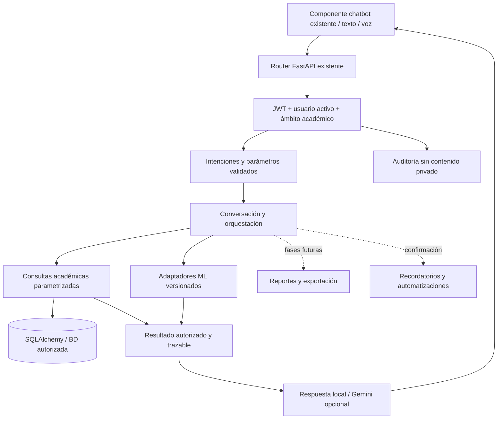

# Parte 7 — Monitor IA Assistant: plan de implementación

> Este documento conserva el diagnóstico y los resultados de la primera etapa. La segunda fase implementada y sus pruebas actuales están en [FASE2_CONVERSACION_Y_VOZ.md](FASE2_CONVERSACION_Y_VOZ.md).

## Estado y alcance de esta entrega

Primera etapa: análisis del asistente existente, arquitectura y corrección de autorización.
Base: `origin/main`, commit `90e7ce75c34497350728b9aa02afd74c9e8ca188`, referencias actualizadas el 30/10/2026.
Worktree: `monitor-asistencia-parte7`. Rama: `parte-7-chatbot-inteligente`.
Sin commits, pushes ni merges. Las otras ramas y los tres stash se conservan.
No se solicitaron credenciales, no se abrió una conexión MySQL ni se ejecutaron migraciones.
No se arrancó `app.main`: su arranque tiene efectos sobre la BD y servicios de otros módulos.

## Funcionalidades existentes y componentes que se reutilizan

| Componente | Situación revisada |
| --- | --- |
| `backend/app/api/chatbot.py` | GET `/api/chatbot/context`, POST `/message`, GET y DELETE `/history`; todos bajo autenticación. |
| `backend/app/services/chatbot_service.py` | Intenciones mediante palabras clave, consultas SQLAlchemy parametrizadas y respuesta local verificable. Cursos, asistencia de hoy, historial, tardanzas, estadísticas, próxima clase, predicción y métricas. |
| `backend/app/schemas/chatbot.py` | Mensaje de 1–2000 caracteres, IDs positivos, origen `text` o `voice`, propiedades adicionales rechazadas. |
| `backend/app/api/deps.py` | JWT y consulta del usuario activo en BD. La autorización usa su rol actual, no el rol declarado por el navegador o el JWT. |
| `frontend/components/chatbot.js` | Panel compartido, filtros, historial, sugerencias, accesibilidad, estado de carga, timeout y presentación mediante `textContent`. No se crea un segundo chatbot. |
| `frontend/css/chatbot.css` | Panel responsive y componentes existentes; sin cambios en esta etapa. |
| Voz existente | `SpeechRecognition`/`webkitSpeechRecognition`, idioma es-PE, resultados parciales/finales, cancelación y alternativa de texto. El navegador puede usar un proveedor externo; no es transcripción propia ni conversación de voz bidireccional. |
| Gemini opcional | `GEMINI_API_KEY` y `GEMINI_MODEL`; recibe una respuesta autorizada para redactarla. No tiene herramientas SQL ni autoridad para conceder permisos. Se conserva la alternativa local. |
| Historial | Tabla `chat_historial`, 30 mensajes recientes del propio usuario, borrado solo de su cuenta. No hay memoria conversacional enviada al intérprete: el historial visual no equivale a contexto de diálogo. |
| `database/mysql/05_chatbot.sql` | DDL aditivo de `predicciones`, `metricas_modelo`, `chat_historial`. Revisado como texto; no ejecutado. |
| Servicios académicos | `curso_service`, `nota_service`, `session_service`, asistencia y predicciones: reutilizables solo después de comprobar sus contratos y aplicar el ámbito del asistente. No invocar endpoints globales asumiendo que filtran datos. |

## Hallazgos y correcciones implementadas

1. **Contexto sin cursos:** antes se omitía el filtro `IN` cuando no había cursos, devolviendo estudiantes institucionales. Ahora el filtro siempre existe, incluso vacío; el resultado es vacío.
2. **Rol desconocido:** antes podía obtener todos los cursos al no entrar en ninguna rama. Ahora se deniega explícitamente. Un estudiante sin perfil también se deniega; un profesor sin perfil/asignaciones obtiene ámbito vacío.
3. **ADMIN/SUPERADMIN:** el esquema actual no tiene un catálogo granular de permisos. Se agrega una concesión explícita de lectura institucional del chatbot, local al servidor, sin migración ni cambios en roles de otros módulos.
4. **Resolución de nombres:** se consultaba el directorio completo para comprobar nombres, lo que exponía existencia y producía rechazos inconsistentes. Ahora solo se buscan nombres en el ámbito permitido. Una referencia personal no resuelta se rechaza de forma genérica, sin confirmar si la persona existe. La interpretación sigue siendo heurística: no se promete entender cualquier formulación.
5. **Filtros:** se resuelve primero el curso autorizado y después los estudiantes. Los filtros explícitos no pueden ampliarse por el texto. Nombres ambiguos requieren selección; un nombre que contradice el ID se rechaza.
6. **Próxima clase y predicción:** antes un estudiante compartido podía llevar a sesiones, asistencias y notas de cursos ajenos al profesor. Los ayudantes del chatbot ahora exigen `course_ids` y filtran también las entradas del predictor. El algoritmo y sus pesos no cambian.
7. **Historial tras revocación:** cada nueva respuesta se guarda con una huella del rol, cuenta, cursos y pares de matrícula autorizados. Si cambia ese ámbito, se oculta la respuesta anterior. Se conserva la pregunta del propio usuario. Las respuestas heredadas sin metadatos verificables también se ocultan; no se borran registros. Esta primera solución es conservadora: cualquier cambio del ámbito puede ocultar respuestas todavía válidas.
8. **Auditoría:** logger `monitor.chatbot.security`, evento `chatbot_access_denied` y código interno del motivo. Sin nombres, preguntas, IDs de estudiantes, tokens, SQL ni secretos. Los rechazos no se guardan como conversaciones. El despliegue debe dirigir estos eventos a un colector con retención y controles de acceso; no se añade una tabla ni un servicio en esta fase.
9. **Gemini:** la autorización se completa antes de cualquier llamada externa. Se probó con transporte simulado que un rechazo no invoca Gemini y que una respuesta permitida solo contiene datos del ámbito autorizado. No hubo llamadas reales.

### Concesión institucional explícita

`CHATBOT_INSTITUTIONAL_READ_USER_IDS`: lista separada por comas de IDs de cuentas administrativas autorizadas, definida en el entorno del proceso backend por su operador.
Por defecto está vacía: ADMIN y SUPERADMIN reciben 403 para contexto, consultas y lectura del historial.
Una lista malformada invalida la concesión completa. No admite comodines. Un ID de profesor/estudiante en esa lista no eleva su rol.
No introducir esta propiedad en solicitudes ni tokens. No se cambió la configuración local de ningún servidor.
El borrado del historial propio sigue permitido para roles conocidos aunque no tengan lectura institucional.
Una fase posterior sustituirá esta lista por permisos explícitos persistentes con revocación y auditoría, mediante una migración revisada por el responsable de la BD.

### Contrato de historial sin modificar el esquema

Se conserva `respuesta TEXT`. Las respuestas nuevas contienen un sobre JSON versionado con `chatbot_scope_version`, `scope` y `reply`.
GET `/history` sigue devolviendo `{question, reply}` con texto, compatible con el componente existente.
Las herramientas que lean directamente esa columna deberán interpretar el sobre; inventariarlas antes de desplegar.
La huella es un marcador de ámbito, no cifrado ni firma antimanipulación; se confía en la integridad de la BD.
No hay ejecución de contenido guardado ni SQL derivado del sobre.

## Arquitectura propuesta



| Módulo | Responsabilidad y límite |
| --- | --- |
| Seguridad (`chatbot_security.py`, implementado) | Ámbito en SQL, validación de rol, concesión institucional, rechazos y control del historial. Independiente de Gemini. |
| Intenciones | Extraer intención, entidades y fechas; esquema cerrado de operaciones permitidas. El resultado de un LLM se trata como entrada no confiable y se valida de nuevo. |
| Conversación/contexto | Referencias como «ese curso» dentro del ámbito actual, aislamiento por cuenta, expiración y minimización. Nunca recuperar contexto de otro usuario. |
| Consultas académicas | Métodos de solo lectura con ámbito obligatorio. Consultas de asistencia, notas, cursos y sesiones; límites, paginación y rango temporal. |
| Generador de reportes | Construir resultados estructurados a partir de consultas autorizadas; no SQL libre. |
| Exportación | CSV/PDF/XLSX en memoria o temporales de vida corta, autorización al descargar, protección de fórmulas CSV y sin enlaces públicos de estudiantes. |
| Integración ML | Adaptadores por modelo, versión, procedencia, fecha de corte, variables y limitaciones; explicación fiel sin inventar métricas. |
| Voz/transcripción | Reutilizar voz existente; evaluar privacidad y consentimiento antes de proveedores externos y síntesis de voz. Nada de escucha automática. |
| Recordatorios | Solicitud explícita del usuario, zona horaria, caducidad, cancelación y destinatario verificado. |
| Automatizaciones/auditoría | Tareas permitidas, confirmación de efectos, claves de idempotencia, permisos reevaluados al ejecutar y descargar; registro mínimo de ejecución/rechazos. |

Solo el primer módulo y los ajustes de seguridad en los componentes existentes se implementan ahora. Los demás son diseño para fases posteriores.

## Contratos ML revisados: sin copiar ni hacer merge

### Modelos en main

- `ai/ml/features.py`, `predict.py`, `train.py`, `evaluate.py` y `prediction_service.py`: predictor existente de regresión logística con ocho entradas históricas; salida `probabilidad`, `prediccion`, `etiqueta`, `features_usadas`. No se encontró un contrato equivalente de regresión lineal que deba duplicarse.
- `/api/predictions/student/{estudiante_id}` no es un adaptador directamente seguro para el asistente: además del permiso por estudiante, se necesita limitar los cursos de sus entradas. Se corrigió exclusivamente el camino propio del chatbot; el endpoint ajeno no se modificó.
- Se conservan las limitaciones del modelo existente: selección por fecha, notas sin reconstrucción temporal completa, límite de historial y valor supletorio de notas. Antes de compararlo con Parte 6, hay que fijar la misma cohorte, corte temporal y métricas; no se declara superioridad de ningún modelo.
- `segmentacion/segmentacion_kmeans.py` en esta base de main declara **tres** variables. `segmentacion_service.py` etiqueta la modalidad como `principal_4_variables` y espera campos del adaptador ampliado. Hay una inconsistencia de versiones: no afirmar que este main ofrece el contrato definitivo de cuatro variables sin reconciliación y pruebas en una integración posterior.
- El contrato pretendido de Segmentación IA tiene `variables`, `metricas`, `puntos`, `clusters`, proyección PCA, siluetas, evaluación K y expresiones sintéticas opcionales. No usarlo para perfilar estudiantes reales ni enlazar EmoScan. Esta fase no ejecuta ni modifica K-Means.

### Parte 6 remota

Revisada por `git show origin/parte-6-red-neuronal:...`, sin checkout, copia ni merge.
Referencia: `68430e14d481c37b4f898969f40a36bb0abadc27`.

- `red_neuronal/inference.py`: contrato interno `AttendanceInference.predict(values, source, cutoff, session_at)` con nueve variables históricas validadas, corte anterior al objetivo y día/hora coherentes con la sesión.
- Entradas: `asistencia_30d`, `tardanzas_30d`, `asistencia_ultimas5`, `sesiones_previas`, `promedio_previo`, `sin_notas`, `dia_sin`, `dia_cos`, `hora`.
- Red 9 → 32 ReLU → 16 ReLU → 1 sigmoide, 865 parámetros. Modelo y scaler congelados, identificación/versionado de artefactos, sin reentrenamiento durante una consulta.
- `red_neuronal/api.py`: `/api/parte6/report`, `/api/parte6/predict`, demostración sintética y autorización docente.
- `backend/app/api/parte6_system.py`: `/api/parte6/system/{courses,...,context,predict}`; selección pública exclusivamente por `curso_id`, `estudiante_id`, `sesion_id`, revisión de permisos y bloqueo si el contexto histórico no está listo. Integración MySQL experimental, no una validación con datos reales.
- Adaptador futuro: recibir selección autorizada, construir contexto histórico del servidor, llamar al contrato interno y presentar probabilidad, versión, procedencia, corte y advertencia. No aceptar nueve valores académicos arbitrarios del navegador para inferencia institucional.

## Archivos de esta etapa y de las siguientes

Modificados ahora:

- `backend/app/api/chatbot.py`: contexto, guardado y lectura de historial seguros; se conservan rutas y respuesta pública.
- `backend/app/services/chatbot_service.py`: reutilización de política, resolución acotada y filtros en consultas de próxima clase/predicción.

Creados ahora:

- `backend/app/services/chatbot_security.py`.
- `backend/tests/parte7/conftest.py` y `test_chatbot_security.py`.
- `docs/parte7/PLAN_IMPLEMENTACION.md` (este archivo).

Candidatos para futuras fases, todavía sin modificar: `schemas/chatbot.py`, `frontend/components/chatbot.js`, `frontend/css/chatbot.css`; servicios nuevos de intenciones/contexto/reportes/ML/recordatorios solo cuando toque cada fase. Cualquier DDL nuevo necesita revisión y entorno de desarrollo; no ejecutar `05_chatbot.sql` en la nube como parte de esta entrega.

## Riesgos y tareas pendientes

- Hay valores de configuración sensibles/fallback heredados en `core/config.py` y selección de credenciales cloud en `db/database.py`. No se imprimieron sus valores ni se cambiaron archivos ajenos. Antes de desplegar, el responsable debe retirar/rotar esos secretos, eliminar fallbacks y exigir configuración explícita. No basta ocultarlos en la interfaz.
- El arranque actual puede crear tablas y activar servicios de otros módulos. Las pruebas importan únicamente el router, nunca `app.main`.
- Los endpoints existentes de sesiones no aplican el mismo ámbito fino; no reutilizarlos como atajo. No se auditó ni corrigió toda la aplicación en esta fase.
- Gemini puede redactar de forma incorrecta aunque su entrada esté autorizada. Se necesita validación de salida estructurada y revisión de consentimiento/minimización antes de habilitar envío de información académica a terceros. No se habilitó Gemini ni se probó su disponibilidad real.
- La interpretación por subcadenas falla con sinónimos, negaciones, fechas, múltiples nombres y seguimiento conversacional. No se confunde una denegación segura con comprensión semántica completa.
- No hay rate limiting propio del chatbot; planear límites por cuenta, cuotas Gemini y protección de recursos.
- Las autorizaciones son una instantánea dentro de la transacción. Para tareas largas/asíncronas reevaluar al terminar y antes de entregar; el historial agrega invalidación conservadora, no aislamiento transaccional distribuido.
- Historial contiene preguntas/respuestas académicas en texto: definir retención, eliminación, respaldo y acceso de operadores. Esta fase no elimina registros heredados ni configura cifrado.
- No hay sistema proactivo nuevo, reportes, exportación ni conversación por voz completa implementados todavía.

## Dependencias y reproducción de pruebas

No se añadieron dependencias. Python 3.12 es el entorno usado. `requirements-chatbot.txt` ya incluye `requirements-base.txt`, `requirements-ai.txt` y tzdata: FastAPI, SQLAlchemy, Pydantic, jose, httpx, pytest, NumPy/scikit-learn y dependencias del predictor existente.
No se necesita TensorFlow, API key ni credenciales MySQL para esta primera etapa.

En PowerShell desde el nuevo worktree, con un entorno Python preparado:

```powershell
python -B -m pytest backend/tests/parte7 -q -p no:cacheprovider
```

Para preparar un entorno separado más adelante, sin tocar los existentes:

```powershell
py -3.12 -m venv .venv
.\.venv\Scripts\python.exe -m pip install -r requirements-chatbot.txt
.\.venv\Scripts\python.exe -B -m pytest backend/tests/parte7 -q -p no:cacheprovider
```

En esta sesión se reutilizó únicamente el ejecutable de un entorno ya instalado, sin instalar ni cambiar paquetes ni archivos de Parte 6.
El harness usa FastAPI y el router reales, JWT firmados para cuentas ficticias y SQLite en RAM. El usuario se resuelve mediante `get_current_user`; solo se sustituye la sesión DB. Un listener bloquea conexiones al engine MySQL. Gemini y el predictor se sustituyen en las pruebas que comprueban sus entradas: estos tests no miden calidad predictiva ni entrenan modelos.

### Resultado y cobertura

**58 pruebas aprobadas**. Una advertencia de obsolescencia Starlette/AnyIO, sin fallos.
Se cubren autenticación, usuario inactivo, rol del token sin autoridad, estudiante propio, profesores sin perfil/cursos, estudiantes sin perfil/matrículas, ADMIN/SUPERADMIN con y sin concesión, configuración inválida, manipulación de IDs/propiedades/nombres, inyección SQL/prompt, filtros de curso, próxima clase, entradas de predicción, revocación, aislamiento/borrado del historial, respuestas heredadas y auditoría sin contenido privado.

No se ejecutó la suite completa del proyecto ni una conexión de navegador/voz real. Los tests heredados `test_chatbot.py`/`test_chatbot_auth.py` dependen de fixtures `client`/`headers` que no tienen un conftest compartido en esta base; la suite nueva es independiente y reproducible. Node.js no está disponible en el PATH de este entorno: no se ejecutó `frontend/tests/chatbot.voice.test.mjs`. El frontend no se modificó.

### Plan de pruebas para las siguientes fases

1. Mantener los casos de ámbito vacío, roles, filtros, revocación y referencias personales como barrera obligatoria.
2. Añadir casos de intenciones ambiguas, fechas/zona horaria, referencias de conversación y cambios de permisos entre turnos.
3. Probar adaptadores ML con cohortes/cortes controlados, artefactos ausentes, trazabilidad y sin información futura.
4. Exportación: autorización al crear/descargar, fórmula CSV, expiración, nombres de archivo seguros, cuotas y errores de generación.
5. Voz: Chrome con permiso concedido/denegado, cancelación, desconexión, HTTPS/localhost y consentimiento real; no simular que un micrófono físico funciona.
6. Automatizaciones: petición explícita, cancelación, idempotencia, cronología, permisos revocados y ausencia de ejecuciones arbitrarias.
7. Integración con BD de desarrollo solamente después de configurar y revisar explícitamente el arranque seguro. Nunca usar producción para tests.

## Orden de implementación

1. **Esta entrega:** aislamiento Git, inventario, arquitectura, ámbito y regresiones de seguridad.
2. **Fase 2:** intérprete estructurado y contexto conversacional sobre el mismo chatbot; mantener consultas locales deterministas y pruebas de permisos.
3. Adaptadores ML versionados de solo lectura; reconciliar antes el contrato K-Means y revisar integración de Parte 6 por separado.
4. Reportes y descargas autorizadas, primero en memoria, con controles de tamaño y contenido.
5. Evolución de voz con consentimiento y minimización.
6. Recordatorios a petición y automatizaciones limitadas, persistencia revisada, auditoría e idempotencia.
7. Revisión integral, pruebas de desarrollo y aprobación de despliegue por los responsables. Sin merges automáticos.

## Referencias técnicas

- [OWASP API1: autorización por objeto](https://api-security.owasp.org/editions/2023/en/0xa1-broken-object-level-authorization/): validar el acceso al objeto en cada operación del servidor.
- [SQLAlchemy: expresiones IN y colecciones vacías](https://docs.sqlalchemy.org/en/20/core/operators.html#empty-in-expressions): mantener el filtro vacío produce un conjunto vacío, no acceso global.


## Avance: tercera fase

Reportes académicos, exportaciones y pruebas implementados localmente. Véase [FASE3_REPORTES_ACADEMICOS.md](FASE3_REPORTES_ACADEMICOS.md), incluidos límites, ejemplos verificados y restricciones de despliegue.

## Avance: cuarta fase — ML de solo lectura

Consultas y reportes integrados al chatbot existente. Véase [FASE4_INTEGRACION_ML.md](FASE4_INTEGRACION_ML.md) para contratos, permisos, procedencia y dependencias pendientes de Parte 6.

## Avance: quinta fase — proactividad revisable

Recordatorios, alertas, reportes programados, borradores y centro de notificaciones. Véase [FASE5_ASISTENTE_PROACTIVO.md](FASE5_ASISTENTE_PROACTIVO.md). Migración aditiva preparada para revisión, sin ejecutarla en MySQL.
